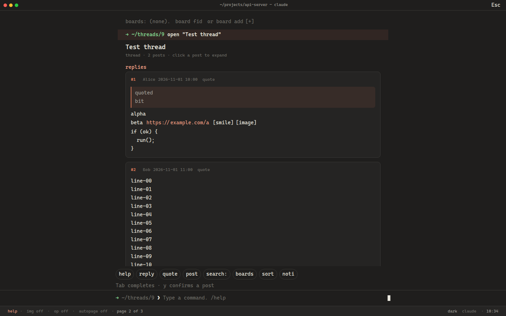

[中文说明](README.zh-CN.md)

# NGA Code Agent Disguise

A Tampermonkey script that shows NGA (`bbs.nga.cn`, `ngabbs.com`, `bbs.ngacn.cc`, `nga.178.com`) as a Claude Code or Codex CLI session.



## Install

1. Install [Tampermonkey](https://www.tampermonkey.net/).
2. Open [nga-code-agent-disguise.user.js](https://raw.githubusercontent.com/aromaw/nga-code-agent-disguise/main/nga-code-agent-disguise.user.js).

`@updateURL` and `@downloadURL` point at that file on `main`.

## How it reads

The thread title, floor, author, time, and recommend count are separate. Quotes sit on an accent bar. Long posts stop at 14 lines; click the card or `expand N more lines`. Images stay `[image]` until you click one or turn `img` on, which loads lazy thumbnails. URLs in the body are links. The text column is 92 characters wide so a wide monitor does not stretch lines. The prompt and status stay on screen.

A row of chips above the prompt starts the common commands. `Tab` completes the rest. `y` is required before a reply, a new thread, a bookmark, or a vote is sent.

## Keys

`` ` `` toggles the disguise. It does not fire in a text field, during IME composition, or on the key that confirms an IME candidate. `togglekey f2` stores another shortcut. `togglekey reset` restores the backtick.

| Key | Action |
| --- | --- |
| `` ` `` | Toggle the disguise, outside text fields |
| `Esc` | Close help or a draft. Otherwise show the static cover. `Esc` or Resume returns. |
| `Ctrl+[` | Leave the command line |
| `Tab` | Complete a command |
| Up / Down | Command history |
| Click a collapsed post | Expand that post |

Vim is off until you run `vim`. Then, and only outside a text field: `j`/`k` scroll, `h`/`l` scroll one screen and do not change pages, `gg`/`G` jump to the ends, digits then Enter open a topic, `/` prefills search, `:` or `i` focus the prompt, `o` prefills `open` or `search:`, `t` cycles the theme, `?` opens help, `Ctrl+o` expands every post.

`next` and `prev` are what change pages.

## Commands

A leading `/` is optional.

```
help
ls                         list loaded topics or floors
open <n>                   open topic n on a board
next · prev · go page <n> · top
floor <n>                  scroll to a floor, or open its page
sort reply · sort post     latest reply, or latest new thread
search: <words>            this board when a fid is known
search: -g <words>         the whole site
op                         only the original poster, and keep appending those pages
author <uid|name>          this person's posts, via authorid
author off
board list · board add [name] · board <n> · board del <n> · board fid <fid>
bookmark · unbookmark      this thread. y confirms
bookmark list              threads saved here, plus NGA's favorite page
reply [text]
reply <floor> [text]
quote <floor> [text]
post [title]               new thread in the current board. y confirms
vote <floor>               recommend that floor. y confirms
user [uid|name]            uid, location, floors on this page, profile link
whoami
noti                       notification links from the page, or the noti screen
img · expand · vim · autopage · compact · pause
theme · claude · codex · dark · light · togglekey <key>
y · n · edit               send, cancel, or revise the pending preview
clear · exit · version · pwd
```

State-changing commands copy a form or link from the page when one is there. Otherwise they post to the same host the forum uses: `post.php` for replies and new threads, `nuke.php` `topic_favor` for bookmarks, `nuke.php` `post_recommend` for votes, and `nuke.php?func=noti` or `thread.php?favor=1` for inbox and favorites. Nothing in that list is sent before `y`. The script does not ask for a password.

## Development

```sh
npm install
npm test
```

`npm test` runs `node --test tests/disguise.test.js` with jsdom and `tests/fixtures/`. The tests do not contact NGA. Bookmark, vote, new-thread, and notification calls were not exercised against the live site.
