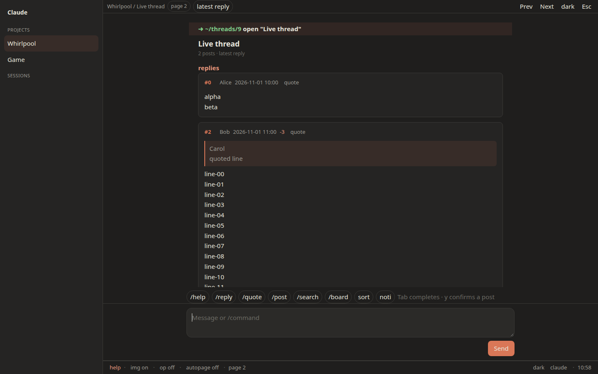

[中文说明](README.zh-CN.md)

# NGA Code Agent Disguise

A Tampermonkey script that shows NGA (`bbs.nga.cn`, `ngabbs.com`, `bbs.ngacn.cc`, `nga.178.com`) as a Claude or Codex desktop session: a project sidebar, a conversation in the main pane, and a composer along the bottom.



## Install

1. Install [Tampermonkey](https://www.tampermonkey.net/).
2. Open [nga-code-agent-disguise.user.js](https://raw.githubusercontent.com/aromaw/nga-code-agent-disguise/main/nga-code-agent-disguise.user.js).

`@updateURL` and `@downloadURL` point at that file on `main`.

## How it reads

Boards and bookmarks sit in the left sidebar. The top bar is the board, the thread, the page, and the active sort or filter. Posts are message cards: floor, author, time, and recommend count in the header, quotes as a nested block with the author, images as thumbnails when `img` is on and as an `[image]` link when it is off. Long posts collapse; click the card or `expand N more lines`.

The composer is multi-line. Enter or Send runs the text. Shift+Enter inserts a line. Typing `/` opens a command menu that filters as you type; arrow keys move, Enter selects, and Tab completes (`/he` becomes `/help`). Chips insert the same commands. `boards` is the same as `board list`. A backtick does not close the overlay while the composer is focused, and the key that opens the overlay is not typed into the composer. Esc, including from the composer, covers the whole viewport with a code-review editor (file tree, tabs, a numbered diff).

Send, and `y`, are required before a reply, a new thread, a bookmark, or a vote. Cancel, and `n`, name the thing you cancelled.

## Names and fetches

Every response is decoded as GBK. A body that is already clean UTF-8 is kept; when both decoders look equally clean, UTF-8 wins. A cached favorites list that is garbled (U+FFFD, or the `¼` left by reading GBK `录` as Latin-1) is dropped and fetched again.

Display names come from the page, in this order: `commonui.userInfo.setAll` (including a hex `uuname`), quote `userlink`s, and author links on the board or favorites page. A name found that way is cached. The ucp GET is only used when the page has no name, and the first HTTP 503 in a session stops every later ucp call. `debug names` (not in the slash menu) prints how many names are resolved and which source each one came from: `page-userinfo`, `page-dom`, `cache`, or `ucp`.

NGA itself prints `UID:` for an author it has not named on this account. That label is left as-is. The script does not open profile pages or call any other endpoint to fill it in.

## Keys

`` ` `` toggles the disguise. It does not fire in a text field, during IME composition, or on the key that confirms an IME candidate. `togglekey f2` stores another shortcut. `togglekey reset` restores the backtick.

| Key | Action |
| --- | --- |
| `` ` `` | Toggle the disguise, outside text fields |
| `Esc` | Close help or a draft. Otherwise cover the viewport with the code-review editor. `Esc` returns. |
| `Ctrl+[` | Leave the command line |
| `Tab` | Complete a command |
| Up / Down | Command history |
| Click a collapsed post | Expand that post |

Vim is off until you run `vim`. Then, and only outside a text field: `j`/`k` scroll, `h`/`l` scroll one screen and do not change pages, `gg`/`G` jump to the ends, digits then Enter open a topic, `/` prefills search, `:` or `i` focus the prompt, `o` prefills `open` or `search:`, `t` cycles the theme, `?` opens help, `Ctrl+o` expands every post.

`next` and `prev` are what change pages.

## Commands

A leading `/` is optional.

```
help
ls                         list loaded topics or floors
open <n>                   open topic n on a board
next · prev · go page <n> · top
floor <n>                  scroll to a floor, or open its page
sort reply · sort post     latest reply, or latest new thread
search: <words>            this board when a fid is known
search: -g <words>         the whole site
op                         only the original poster, and keep appending those pages
author <uid|name>          this person's posts, via authorid
author off
board list · board add [name] · board <n> · board del <n> · board fid <fid>
bookmark · unbookmark      this thread. y confirms
bookmark list              threads saved here, plus NGA's favorite page
reply [text]
reply <floor> [text]
quote <floor> [text]
post [title]               new thread in the current board. y confirms
vote <floor>               recommend that floor. y confirms
user [uid|name]            uid, location, floors on this page, profile link
whoami
noti                       notification links from the page, or the noti screen
img · expand · vim · autopage · compact · pause
theme · claude · codex · dark · light · togglekey <key>
y · n · edit               send, cancel, or revise the pending preview
clear · exit · version · pwd
```

State-changing commands copy a form or link from the page when one is there. Otherwise they post to the same host the forum uses: `post.php` for replies and new threads, `nuke.php` `topic_favor` for bookmarks, `nuke.php` `post_recommend` for votes, and `nuke.php?func=noti` or `thread.php?favor=1` for inbox and favorites. Nothing in that list is sent before `y`. The script does not ask for a password.

## Development

```sh
npm install
npm test          # jsdom: disguise.test.js, fixes.test.js, dumps.test.js
npm run shots     # Playwright screenshots against the dumps, written to /workspace/nga-dev-shots
```

`npm test` uses jsdom and `tests/fixtures/`. It does not contact NGA. `tests/dumps.test.js` skips when `/workspace/nga-dom` is absent. Version 4.1.3 is the behavior in [CHANGELOG.md](CHANGELOG.md): GBK decoding, the favorites cache, page-first names, `debug names`, the Esc cover, the slash menu, quotes, floors, pids, images, and OP mode were checked on live `bbs.nga.cn`. Writes still wait for `y` and use the form already on the page.
