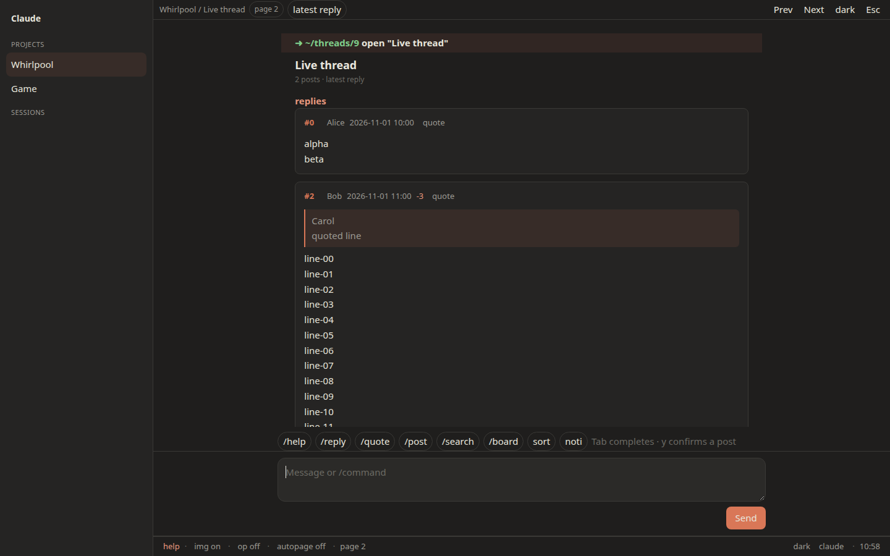

[English](README.md)

# NGA Code Agent 伪装

Tampermonkey 脚本。把 NGA（`bbs.nga.cn`、`ngabbs.com`、`bbs.ngacn.cc`、`nga.178.com`）显示成 Claude 或 Codex 桌面会话：左侧是版块和收藏，中间是对话，底部是输入框。



## 安装

1. 安装 [Tampermonkey](https://www.tampermonkey.net/)。
2. 打开 [nga-code-agent-disguise.user.js](https://raw.githubusercontent.com/aromaw/nga-code-agent-disguise/main/nga-code-agent-disguise.user.js)。

`@updateURL` 和 `@downloadURL` 指向 `main` 上的这个文件。

## 阅读

版块和收藏在左侧。顶栏是版块、帖子、页码，以及当前的排序或筛选。楼层是消息卡片：楼层号、作者、时间和推荐数在头上，引用是嵌套块并带作者，`img` 打开时图片是缩略图，关闭时是 `[image]` 链接。长楼层会折叠，点击卡片或 `expand N more lines` 展开。

底部输入框可以多行。Enter 或 Send 执行，Shift+Enter 换行。输入 `/` 会弹出命令菜单，边输入边过滤，方向键移动，Enter 选中，Tab 补全（`/he` 变成 `/help`）。按钮插入同样的命令。`boards` 等于 `board list`。焦点在输入框里时，反引号不会关掉伪装，打开伪装的那一下也不会打进输入框。Esc，包括在输入框里，会用一整屏代码审阅界面（文件树、标签、带行号的 diff）盖住窗口。

回复、新帖、收藏和投票都要按 Send 或 `y` 才会发出。Cancel 和 `n` 会按动作本身来写取消文案。

## 用户名与请求

所有响应都按 GBK 解码。已经是干净 UTF-8 的正文会保留；两种解码都干净时，采用 UTF-8。收藏缓存里如果有乱码（U+FFFD，或把 GBK 的「录」读成 `¼`），会丢掉并重新拉取。

显示名先从页面取，顺序是：`commonui.userInfo.setAll`（含十六进制 `uuname`）、引用里的 `userlink`、版块或收藏页上的作者链接。取到的名字会缓存。只有页面上没有名字时才请求 ucp；同一次会话里第一次 HTTP 503 之后不再请求。`debug names` 不在斜杠菜单里，它会列出已解析的数量，以及每个名字的来源：`page-userinfo`、`page-dom`、`cache` 或 `ucp`。

这个账号上，NGA 自己会对未署名的作者显示 `UID:`。脚本保留这个标签，不会打开个人资料页，也不会再打别的接口去补名字。

## 按键

反引号 `` ` `` 切换伪装。文本框里、输入法组字时、以及确认候选词的那一下，都不会触发。`togglekey f2` 可以换成别的键。`togglekey reset` 恢复反引号。

| 按键 | 作用 |
| --- | --- |
| `` ` `` | 在文本框之外切换伪装 |
| `Esc` | 先关掉帮助或草稿，否则用整屏代码审阅界面盖住窗口。再按 `Esc` 回来 |
| `Ctrl+[` | 离开命令行 |
| `Tab` | 补全 |
| 上 / 下 | 命令历史 |
| 点击被折叠的楼层 | 展开这一层 |

`vim` 默认关闭。打开之后，并且焦点不在文本框里：`j`/`k` 滚动，`h`/`l` 滚动一屏且不翻页，`gg`/`G` 到顶或到底，数字后按 Enter 打开列表里的帖子，`/` 预填搜索，`:` 或 `i` 聚焦命令行，`o` 预填 `open` 或 `search:`，`t` 切换主题，`?` 打开帮助，`Ctrl+o` 展开全部楼层。

翻页用 `next` 和 `prev`。

## 命令

前面的 `/` 可有可无。

```
help
ls                         列出已加载的帖子或楼层
open <n>                   打开版块列表里的第 n 帖
next · prev · go page <n> · top
floor <n>                  滚到这一层，或打开它所在的页
sort reply · sort post     按最新回复，或按最新发布
search: <词>               能确定 fid 时搜本版
search: -g <词>            全站
op                         只看楼主，并继续往后接楼主页
author <uid|名字>          用 authorid 只看这个人
author off
board list · board add [名字] · board <n> · board del <n> · board fid <fid>
bookmark · unbookmark      收藏或取消收藏当前帖。需要 y
bookmark list              本机记下的帖子，以及 NGA 的收藏页
reply [正文]
reply <楼层> [正文]
quote <楼层> [正文]
post [标题]                在当前版块发新帖。需要 y
vote <楼层>                推荐这一层。需要 y
user [uid|名字]            uid、属地、本页楼层、资料链接
whoami
noti                       从页面上的通知链接，或通知页，列出帖子
img · expand · vim · autopage · compact · pause
theme · claude · codex · dark · light · togglekey <键>
y · n · edit               发送、取消，或回到预览前的编辑
clear · exit · version · pwd
```

会改论坛数据的命令，优先用页面上已有的表单或链接。页面上没有时，才向论坛自己的地址提交：回复和新帖走 `post.php`，收藏走 `nuke.php` 的 `topic_favor`，投票走 `post_recommend`，通知和收藏列表走 `nuke.php?func=noti` 或 `thread.php?favor=1`。这些在输入 `y` 之前都不会发出。脚本不索取密码。

## 开发

```sh
npm install
npm test          # jsdom：disguise.test.js、fixes.test.js、dumps.test.js
npm run shots     # 用 Playwright 对 dumps 截图，写到 /workspace/nga-dev-shots
```

`npm test` 使用 jsdom 和 `tests/fixtures/`，不访问 NGA。没有 `/workspace/nga-dom` 时 `tests/dumps.test.js` 会跳过。4.1.3 的行为见 [CHANGELOG.md](CHANGELOG.md)：GBK 解码、收藏缓存、优先从页面取用户名、`debug names`、Esc 遮屏、斜杠菜单、引用、楼层、pid、图片和只看楼主，已在 `bbs.nga.cn` 上核对过。会改数据的操作仍然要等 `y`，并使用页面上已有的表单。
